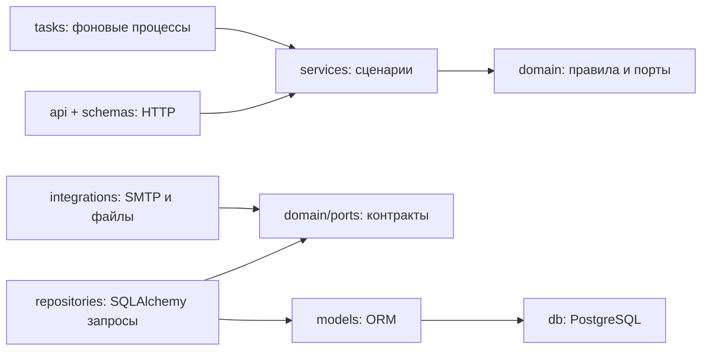

# Перенос backend Organization ERP на Python: архитектура и ограничения

Дата: 28 сентября 2026. Статус: проект решения для постепенного выполнения; реализация не начата.

## Цель

Полностью перенести backend ERP на Python, сохранив Next.js/React frontend и существующие пользовательские возможности. Получить понятный проект для подготовки к работе Python backend разработчиком: самостоятельно прослеживать запрос, менять правила, писать тесты и объяснять архитектурные решения.

Пользователь явно выбрал FastAPI, SQLAlchemy, постепенный перенос с учебными паузами и слоистую архитектуру. pytest входит в основной стек. Существующие метрики и фоновые задачи переносятся на Python. Redis, Celery и другие отсутствующие технологии пользователь хочет добавить самостоятельно: они исключены из обязательного переноса. Календарные сроки, версии пакетов и расход токенов уточняются по первому рабочему модулю.

## Подтверждённая исходная точка

- Next.js/TypeScript + Prisma + PostgreSQL 15; 102 `route.ts`, 51 модель Prisma.
- Около 21 тысячи строк серверного кода в API, сервисах, контрактах, общей инфраструктуре и worker; около 7,3 тысячи строк тестов этих частей. Это подсчёт файлов, а не оценка сложности каждой строки.
- `src/features/` уже разделён на бизнес-модули. Серверные страницы импортируют application-сервисы; некоторые страницы используют Prisma непосредственно.
- NextAuth Credentials, Argon2id, `sessionVersion`, обязательная смена пароля, роли и ограничения по подразделениям/проектам. Перенос одной проверки `role == ADMIN` не сохраняет текущую модель доступа.
- Worker `src/worker/notification-worker.ts` опрашивает очередь каждые 30 секунд. Outbox использует `FOR UPDATE SKIP LOCKED`, lease 5 минут, claim token, до 5 попыток и повтор после истечения lease.
- Есть Collector, Prometheus, Grafana, Tempo, dashboards и alerts в `ops/observability/`. Установка нового параллельного стека не нужна.
- Финансовые периоды блокируются через `FOR UPDATE`; документы имеют версии, контроль SHA-256 и отдельный volume. `AuditLog` защищён от изменения на уровне Prisma extension.
- Эти выводы получены чтением кода. В рамках подготовки документов приложение и нагрузочные проверки не запускались.

## Выбранный подход и альтернативы

Выбран постепенный перенос в том же репозитории: новый `backend/`, Python и старый backend временно работают на одной учебной копии PostgreSQL. Владелец HTTP-маршрутов переключается целой группой; операции записи не исполняются одновременно в двух реализациях. Next.js остаётся frontend и временным HTTP-адаптером.

Полный перенос одним запуском усложняет поиск регрессий и лишает пользователя учебных остановок. Отдельный Python-проект только с частью ERP быстрее запускается, но не достигает цели полного переноса. Поэтому конечная цель полная, а каждый шаг ограничен одним этапом.

## Слоистая архитектура по образцу пользователя

Выбрана общая структура по слоям, как на предоставленном скриншоте. Это один Python backend, а не отдельные микросервисы. Внутри слоёв файлы группируются по бизнес-областям.



Runtime-вызов проходит `api → services → repository → PostgreSQL`. В исходном коде services зависят от интерфейсов `domain/ports`; конкретные repository и интеграции передаются через composition root. Domain содержит чистые правила; ports — отдельный пакет чистых Python Protocol для границы с инфраструктурой.

### Дерево нового backend

```text
backend/
  pyproject.toml, uv.lock, .python-version, Dockerfile
  alembic.ini, migrations/
  app/
    __init__.py
    main.py                    # create_app(), lifespan
    api/
      router.py
      dependencies.py         # Depends и получение сервисов
      errors.py               # domain/application error → HTTP
      routes/                 # departments.py, assets.py и другие модули
    core/
      config.py               # pydantic-settings
      context.py              # чистые Actor, RequestContext, PermissionTarget
      container.py            # сборка сервисов и concrete adapters
      logging.py
      observability.py
      middleware.py
    db/
      base.py                 # DeclarativeBase и naming conventions
      session.py              # engine и session factories
      registry.py             # импорт ORM-моделей для mapper/Alembic
      uow.py                  # реализация UnitOfWork
    domain/
      errors.py
      ports/                  # repository, UoW, StoragePort, EmailSender
      departments/            # rules.py, entities.py при необходимости
      employees/, projects/, assets/, documents/
      approvals/, timekeeping/, finance/, procurement/
    models/                   # только SQLAlchemy ORM-модели по областям
    repositories/             # реализация предметных DB-запросов
    schemas/                  # Pydantic HTTP input/output, camelCase aliases
    services/
      dto/                    # dataclass inputs/results для сценариев
      departments.py, employees.py, projects.py
      # остальные бизнес-сервисы по мере переноса
    integrations/
      auth_bridge.py          # временная проверка signed bridge
      document_storage.py
      smtp.py
      document_rendering.py
      exports.py
    scripts/                  # seed, verify_data, create_admin
    tasks/
      notifications.py        # отдельный Python outbox process
      scheduled_alerts.py
  tests/{unit,integration,contracts,architecture}/
```

Папки создаются при появлении их реального кода, а не пустыми заранее. `admin/` со скриншота не означает установку отдельного admin framework: существующие admin endpoints остаются в `api/routes/users.py` и соответствующих сервисах. `__pycache__` — генерируемая папка, в Git не добавляется.

### Ответственность и направление зависимостей

| Папка | Ответственность | Правило |
|---|---|---|
| `api` | HTTP, Depends, actor, статусы ответов | Вызывает services; SQL и commit запрещены |
| `schemas` | Pydantic request/response и JSON aliases | Используется на HTTP-границе; ORM наружу не отдаётся |
| `services` | Use cases, доступ, транзакционные сценарии | Импортирует domain, ports, чистый context и dataclass DTO |
| `domain` | Инварианты, вычисления, статусы, ошибки, Protocol-порты | Стандартная библиотека и чистые context-типы; без ORM/HTTP |
| `repositories` | SQLAlchemy queries и реализация портов | Импортирует models, domain, db; не вызывает services |
| `models` | SQLAlchemy mapping таблиц/relationships | Не содержит бизнес-сервисы и HTTP schemas |
| `db` | Пулы, lifecycle session и UoW, registry | `uow.py` собирает repository на одной session |
| `integrations` | Storage, SMTP, rendering, временный auth bridge | Реализует порты; не решает бизнес-статусы |
| `tasks` | Цикл worker, расписание, shutdown | Вызывает services; не копирует бизнес-логику |
| `core` | Настройки, logging, metrics и composition | `container.py` единственное общее место сборки зависимостей |
| `scripts` | CLI команды | Вызывают services; не имеют независимого набора бизнес-правил |

В `services` и `domain` запрещены импорты FastAPI, Pydantic, SQLAlchemy и concrete repositories/integrations. Исключения сборки: `main.py`, `core/container.py`, `api/dependencies.py`, `db/uow.py`, Alembic и test fixtures. `core/context.py` — чистые dataclass/enum, без settings/HTTP. Не считать весь `core` разрешённой зависимостью domain.

У каждой сущности не обязаны быть пять одинаковых файлов. Порт описывает предметные операции (`get_for_update`, `list_visible`), а не универсальный CRUD. Не вводить `BaseRepository[T]`, универсальный Service и событийную шину. Простые read use cases возвращают dataclass DTO; отдельная domain entity нужна там, где есть поведение.

### Контракты транзакций

- `Actor`: `user_id`, `employee_id`, `session_version`, `permissions`, scope grants; текущие права из PostgreSQL.
- `RequestContext`: actor, request_id, технический trace context; без HTTP Request.
- `UnitOfWorkFactory` из `domain/ports/uow.py`: создаёт новый async context manager.
- `UnitOfWork`: async enter/exit, `commit()`, `rollback()` и типизированные repository-порты. Session наружу не отдаётся.
- Изменяющий service открывает один UoW. Вложенные операции принимают тот же UoW. Commit один, после изменений, аудита и outbox; выход без commit откатывает запись.
- Отдельная AsyncSession на запрос/задачу; не делить её между `asyncio.gather()` задачами.
- Не держать DB-транзакцию во время SMTP/генерации большого файла. Письма описываются в PostgreSQL outbox и отправляются после commit.
- Decimal и явное округление; сохраняются реальные SQL names, precision, enum values, nullable, string/CUID IDs и date/timezone семантика.
- Async ORM: eager loading, `expire_on_commit=False`, отсутствие lazy IO в HTTP serialization; проверки N+1 и MissingGreenlet.

## Обязательный стек и новые самостоятельные расширения

| Технология | Задача | Когда |
|---|---|---|
| Python 3.13, uv | Python environment и lockfile | 01 |
| FastAPI, Uvicorn, Pydantic 2, pydantic-settings | HTTP и конфигурация | 01 |
| SQLAlchemy 2.x, asyncpg, Alembic | ORM, транзакции, PostgreSQL migrations | 01–02, handoff 14 |
| pytest, AnyIO asyncio backend, HTTPX, asgi-lifespan | Unit, HTTP и реальные DB-тесты | 01 |
| Ruff, mypy | Проверка Python-кода | 01 |
| argon2-cffi, PyJWT | Существующие пароли и временный bridge | 03 |
| aiosmtplib, Jinja2, openpyxl, python-docx, ReportLab | Аналоги уже имеющихся SMTP/exports | По модулям |
| OpenTelemetry Python | Подключение Python к существующим Collector/Prometheus/Grafana/Tempo | База 01, полный этап 13 |
| Docker Compose, GitHub Actions, Playwright | Текущие запуск/CI/E2E | Каждый этап |

Python 3.13 — проектный выбор, а не утверждение о последней версии. Совместимые точные версии фиксируются в uv.lock на этапе 01; local/CI/Docker используют одну версию. Границы слоёв проверяет pytest AST/import test, дополнительный import-linter необязателен.

Redis, Celery, RabbitMQ, Kafka, S3/MinIO, отдельный admin framework и Kubernetes не входят в обязательную реализацию. В плане будет список самостоятельных упражнений для их будущего введения с конкретной задачей. Базовый перенос сохраняет существующие возможности и не требует этих систем.

## Переходный frontend и авторизация

До этапа 14 NextAuth остаётся единственным владельцем браузерной сессии. С этапа 03 проверка пароля/блокировки и управление пользователями идут через Python; Credentials provider делегирует их внутреннему endpoint. Не делать вторую независимую таблицу сессий на этом этапе.

Next.js после проверки NextAuth session создаёт внутренний JWT с `sub`, `sessionVersion`, `iss=erp-next`, `aud=erp-python`, `iat`, `exp` (60 секунд). Подпись HS256 отдельным `BACKEND_BRIDGE_SECRET`, фиксированный разрешённый алгоритм, без передачи ролей как источника истины. Python проверяет подпись, issuer/audience/expiry, активность пользователя, версию сессии, `mustChangePassword` и загружает scope grants из БД. Доверять входным `x-user-id`/`x-role` нельзя. Bridge token не отдаётся браузеру. Внутренний login endpoint доступен только доверенному BFF с отдельной аутентификацией вызова.

Для каждого перенесённого модуля Next.js route становится тонким адаптером, передающим метод, query/body, bridge token, request ID и traceparent. Прямые server-page imports заменяются вызовами `src/lib/backend/client.ts`. Ошибки сети дают понятный 502/503, без возврата к старой записи. Для персональных ответов `cache: 'no-store'`; streaming download/upload не превращается в JSON.

На этапе 14 браузерная авторизация полностью переходит в FastAPI: opaque случайный session token в HttpOnly cookie, в PostgreSQL только hash токена, срок 8 часов, revoke при logout/смене пароля/деактивации. Cookie SameSite=Lax, Secure в production; небезопасные методы проверяют Origin и CSRF token, отсутствие Origin не обходит CSRF. Браузер обращается к одному origin через BFF, который прозрачно передаёт cookie/Set-Cookie. SSR получает actor через `/api/account/me`; guard не считает наличие cookie доказательством авторизации. Старые NextAuth сессии потребуют повторного входа. Bridge и NextAuth удаляются только после этого переключения.

## Данные и владение миграциями

Разработка и репетиции — на отдельной копии БД и документов. Сохраняются IDs и текущие таблицы. Автоматический reset, `drop_all`, `create_all` на рабочей БД, массовое переименование и смена IDs не входят в план.

На этапе 02 SQLAlchemy описывает все 51 модели; группы можно изучать по очереди с остановкой после каждой. Пока Prisma единственный DDL-владелец. На этапе 14, когда доменные модели перенесены, подготовить полную Alembic baseline, сравнить её с живой схемой, включая ручные constraints/индексы из Prisma SQL. Затем остановить DDL Prisma и передать управление Alembic. Финальная таблица `backend_sessions` создаётся только после этой передачи. Новые фоновые export jobs в обязательный перенос не входят.

Baseline имеет два проверяемых пути: создать эквивалентную схему с нуля; принять существующую копию через `stamp <baseline_revision>` только после доказательства эквивалентности. `stamp` не создаёт таблицы и не подтверждает совпадение схемы. `_prisma_migrations` исключается из удаления/сравнения как служебная история, но сохраняется до окончания переноса. Autogenerate требует ручной проверки.

Один владелец каждой группы HTTP-команд. Общие таблицы могут использоваться соседними модулями, но вызываемый составной сценарий выполняется целиком на Python и в одной транзакции. Скрытые TS writers (SSR actions, скрипты, worker, прямые helpers) входят в реестр. Для неизменившейся схемы откат маршрутов возможен; после изменения схемы нужен отдельный проверенный runbook.

## Надёжность и технологии инфраструктуры

- PostgreSQL outbox переносится с сохранением payload/status semantics. TS и Python worker не запускаются одновременно при переключении. SMTP доставка остаётся at-least-once: падение после принятия письма может дать повтор.
- Python scheduled alerts получают атомарную защиту от параллельного запуска; текущее check-then-upsert не считать достаточной блокировкой. Для mixed phase единственный исполнитель сохраняется.
- Аудит записывается в той же транзакции; неизменяемость защищается Python repository и DB-проверкой/ограничениями после handoff миграций. Не приписывать текущему PostgreSQL гарантию, которая сейчас есть только в Prisma.
- Метрики без employee IDs, email, полного URL, SQL/паролей. Теги HTTP — route template, method, status. Collector недоступен — бизнес-запросы продолжают работать.
- Синхронные экспорты остаются совместимыми по HTTP-поведению; тяжёлый rendering выполняется вне event loop и не держит DB-транзакцию. Отдельная очередь экспортов — самостоятельное последующее упражнение.
- Worker остаётся обычным отдельным Python-процессом с управляемым lifecycle, без Celery.

## Приёмка и учебные остановки

Перенос закончен, когда весь API и все backend-вызовы страниц работают через Python, все 51 исходные модели учтены, нет активных TS writers, фоновые процессы работают, тесты и пользовательские сценарии проходят, восстановление БД/файлов проверено.

Каждый этап заканчивается демонстрацией работающего сценария, перечнем проверок, схемой пути запроса, вопросами для разбора и самостоятельным маленьким упражнением. Агент останавливается и ждёт явной команды пользователя перейти дальше. Отсутствие ответа не означает разрешение продолжать. Документы уже описывают следующие этапы, но не разрешают запускать их все.

Автоматически создавать ветки, коммиты, push и subagents нельзя. При явном запросе пользователя коммиты на русском, имена веток осмысленные без `codex` префикса. Пользовательские незакоммиченные изменения сохраняются; при подготовке плана уже есть изменение `next-env.d.ts`.

## Источники решений

- [FastAPI: lifespan](https://fastapi.tiangolo.com/advanced/events/) и [async tests](https://fastapi.tiangolo.com/advanced/async-tests/) — ресурсный lifecycle и async HTTP-тестирование.
- [SQLAlchemy asyncio](https://docs.sqlalchemy.org/en/20/orm/extensions/asyncio.html) — session per task, eager loading, управление async ресурсами.
- [Alembic autogenerate](https://alembic.sqlalchemy.org/en/latest/autogenerate.html) — сравнение metadata и обязательная проверка generated migrations.

Полный набор поэтапных документов: [план переноса](../plans/2026-09-28-fastapi/00-roadmap.md).
